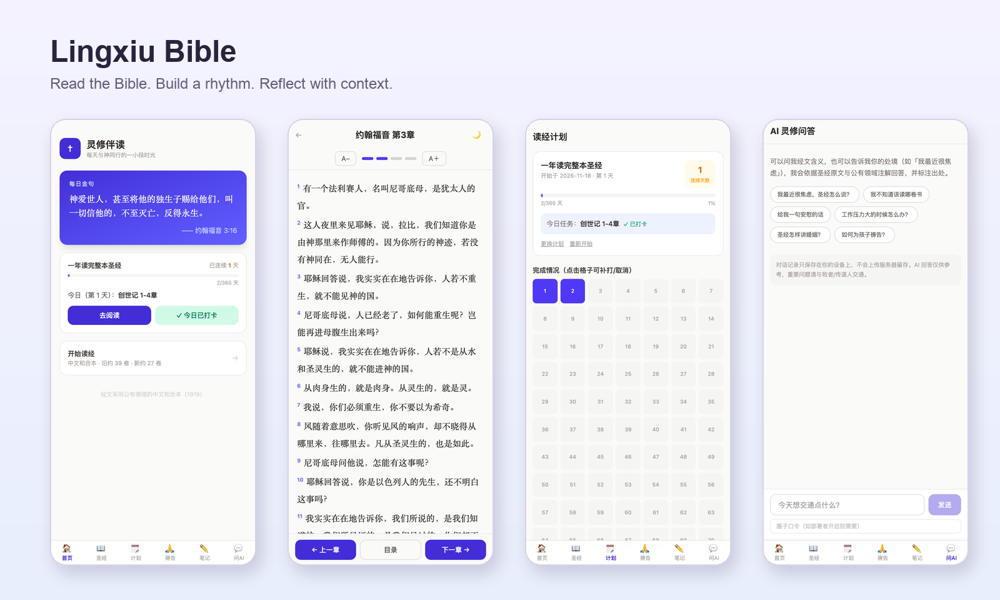

<div align="center">

# Lingxiu Bible — Chinese Devotional PWA

**Read slowly. Return daily. Reflect with context.**

A non-profit, local-first Bible reading and devotional companion for small Chinese-speaking Christian groups. Built around the public-domain Chinese Union Version, reading plans, notes, prayer, and optional scripture-grounded AI conversations.

**[English](README.md) · [简体中文](README.zh-CN.md) · [Open the App](https://lingxiubible.top)**

[](https://lingxiubible.top)
[](https://react.dev/)
[](https://www.typescriptlang.org/)
[](https://web.dev/learn/pwa/)
[](https://workers.cloudflare.com/)
[](#validation)

[Overview](#overview) · [Features](#features) · [Architecture](#architecture) · [Quick Start](#quick-start) · [Validation](#validation) · [Privacy and Sources](#privacy-and-sources)

</div>

---



<a id="overview"></a>
## 1. Overview

Lingxiu Bible (灵修伴读) is designed for groups of roughly **10–100 people** who want a lightweight devotional tool that works inside WeChat or a mobile browser. Add it to the home screen and it behaves like an installable app, including offline access to the complete Bible data.

The product is intentionally focused: no accounts, no social feed, no server-side conversation history, and no commercialisation. Reading progress, bookmarks, notes, prayer items, and AI conversations stay on the user's device.

> **Project boundary:** Non-commercial, small-group use only. It is not an App Store product and is not intended to replace pastoral guidance.

<a id="features"></a>
## 2. Product Features

| Capability | Delivered behavior |
|---|---|
| **Complete Bible reading** | Chinese Union Version with 66 books, 1,189 chapters, book/chapter/verse navigation, four font sizes, dark mode, and chapter gestures |
| **Offline PWA** | Manifest and service worker precache the app and Bible data for home-screen installation and offline reading |
| **Reading plans** | One-year Bible, 90-day New Testament, and 30-day Gospels plans with progress, streaks, calendar check-ins, and backfilling |
| **Search and notes** | Full-text search with highlighted matches, verse bookmarks, notes, a timeline, and JSON export |
| **Verse cards** | Three Canvas-based share-card templates with PNG export and source references |
| **Prayer companion** | Guided prayer, timing, and a local prayer list alongside the reading workflow |
| **Public-domain commentary** | Chapter and verse-level material derived from public-domain sources, with coverage validation |
| **Optional AI devotional Q&A** | Local retrieval of relevant verses, a Cloudflare Worker proxy, streaming responses, source references, rate limits, and an optional group passcode |

AI is an optional layer. If the worker or model is not configured, the reading, plans, notes, prayer, and other local features continue to work.

<a id="architecture"></a>
## 3. Architecture

```text
React 19 + TypeScript + Vite PWA
│
├── Local Bible and commentary data
├── localStorage
│   ├── Settings and reading plans
│   ├── Notes, bookmarks, and prayer items
│   └── AI conversations
│
└── Optional AI request
    ├── Retrieve up to 8 relevant verses in the browser
    ├── POST question + context to /api/ask
    ├── Cloudflare Worker adds instructions and limits
    ├── OpenAI-compatible model endpoint
    └── Streaming response; no API key exposed to the browser
```

One Cloudflare Worker serves the built static assets and handles `/api/ask`. The older Vercel proxy is retained only as an archived implementation; Cloudflare Workers is the maintained deployment path.

## 4. Quick Start

### Requirements

- Node.js 22 or a compatible current LTS release
- npm
- No API key for the local reading application

```bash
git clone https://github.com/Cjj040721/lingxiu-bible.git
cd lingxiu-bible
npm ci
npm run dev
```

Open the local URL printed by Vite, normally `http://localhost:5173`.

Production build and preview:

```bash
npm run build
npm run preview
```

Useful data commands:

```bash
npm run convert:bible
npm run validate:bible
npm run build:verses
npm run validate:commentary
```

For Cloudflare configuration, model settings, rate limits, and deployment details, see the [Chinese documentation](README.zh-CN.md) and [`worker/README.md`](worker/README.md). **Never commit `.env.local` or real API keys.** Production deployment is outside the quick-start flow.

<a id="validation"></a>
## 5. Validation

The current documentation update was checked against the real application:

| Check | Result |
|---|---|
| `npm run build` | Passed; PWA precache generated for 214 entries |
| `npm run lint` | **0 errors**, 4 existing warnings in `settings.tsx` and `ai.ts` |
| `npm run validate:bible` | **36 checks passed**; 66 books / 1,189 chapters / 31,100 verse positions / 31,032 entries |
| `npm run validate:commentary` | **132 checks passed**; 66 books and 4,050 chapter sections |
| Browser walkthrough | Home, John 3 reading, active reading plan, search, and AI page captured locally with no browser console errors |

The screenshots in `docs/assets/` were taken from the local Vite application, not mockups.

## 6. Repository Structure

```text
lingxiu-bible/
├── src/
│   ├── components/          # Navigation, modals, and verse cards
│   ├── data/                # Daily verse selection
│   ├── lib/                 # Bible, plans, notes, prayer, search, AI, and storage
│   ├── pages/               # Home, books, reading, plans, prayer, notes, search, and AI
│   └── types/               # Bible data types
├── public/
│   ├── data/bible/          # Complete Bible data
│   ├── data/commentary/     # Chapter commentary
│   └── icons/               # PWA icons
├── scripts/                 # Conversion, validation, comparison, and generation pipelines
├── worker/                  # Cloudflare AI proxy and deployment guide
├── docs/assets/             # Real application screenshots and README hero
├── README.md                # English product overview
└── README.zh-CN.md          # Detailed Chinese setup, deployment, and data guide
```

<a id="privacy-and-sources"></a>
## 7. Privacy, Content, and Compliance

- **Bible text:** Chinese Union Version (1919), public domain. Source and validation details are documented in the [Chinese guide](README.zh-CN.md).
- **Commentary:** Public-domain source material only; translation and generation provenance is recorded in the data pipeline.
- **Local data:** Settings, progress, notes, bookmarks, prayer items, and conversations remain in local storage.
- **AI requests:** A question and retrieved context are sent to the configured model provider only when the user actively uses AI Q&A.
- **Pastoral boundary:** AI answers include a reference-only disclaimer and are not a substitute for pastoral care.
- Third-party sources retain their original terms. No new licence is claimed for third-party Bible, commentary, or reference content.

## 8. Author and Status

Built and maintained by **Cao Junjia**. The deployed app and complete local reading workflow are available; continued work focuses on content quality, interaction polish, and small-group use rather than commercial distribution.

---

<div align="center">

**Lingxiu Bible — A small daily rhythm of Scripture, reflection, and prayer.**

React + TypeScript + PWA + Cloudflare Workers

</div>
